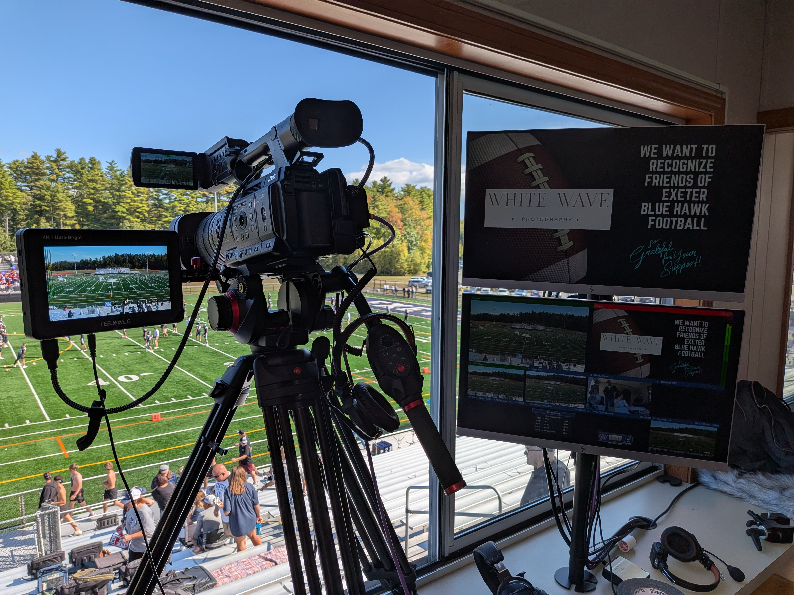
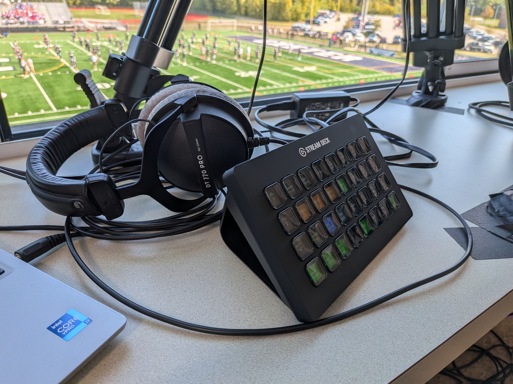

For four weeks every fall, I produce a four-camera football broadcast. I run three manned cameras: a wide, a hero, and a mobile. The fourth is a GoPro focused on our play-by-play announcers. The production also includes video replays, graphics, an intro video, and a highlight reel to wrap up the game. During the game, I run the wide camera and produce the rest of the broadcast, minus the audio, since I have a great audio engineer. The two other camera operators and I are all on comms throughout the game so I can direct. I can also hear the play-by-play in my comms and talk back to the announcers. That got a lot easier this year with the introduction of the Studio Technologies M203 Dante announcer consoles.

My whole video workflow depends on NDI. All four cameras run NDI back to the studio in the school, and program and preview come back to the press box over NDI. The program feed goes to me, our play-by-play announcers, our stadium announcer, and the video monitors at our concession stand.

To run the whole production, I’m using a vMix computer back in the studio, controlled from the press box with a Stream Deck XL. I have macros and shortcuts set up to help automate a lot of what I do.

It’s definitely a challenge producing, directing, and running a camera all at once. It very much keeps me on my toes.

